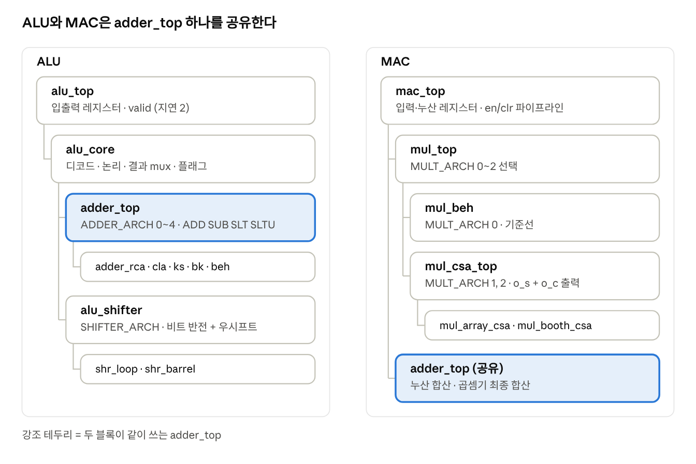
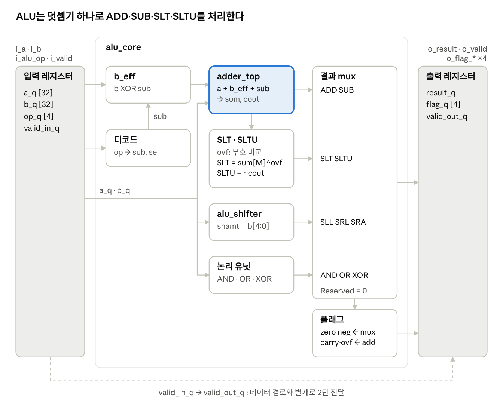
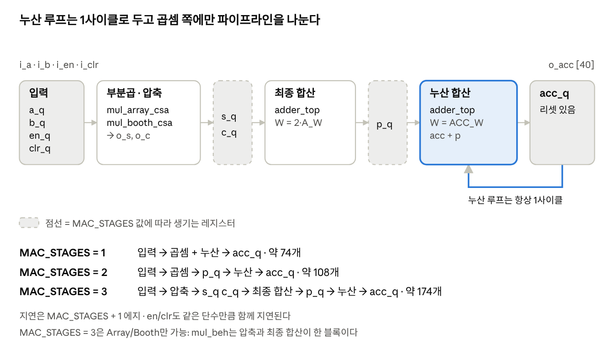

# ALU / MAC 설계 노트

Oct 15, 2026 · @히서

## 개요와 설계 목표

이 노트는 "PI 포트폴리오 프로젝트 계획: 연산 블록 PPA 탐색"의 **RTL 설계 스펙**이다. ALU와 MAC을 여러 구조로 구현하고, 같은 인터페이스·같은 테스트로 기능 동등성을 확인한 뒤, 후속 단계에서 같은 RTL로 합성·비교할 수 있게 구조를 갖추는 것까지를 다룬다. 합성 스크립트, SDC, 결과 분석은 이 노트의 범위 밖이다.

기존에 작성한 "ALU / Datapath 설계 스펙 v0.4"의 구조(i\_/o\_/w\_ 명명, RV32I 인코딩, 덧셈기 공유 수식, 레지스터 정책, T1/T2/T3 측정 단위)를 이어받고, 계획 문서에 있는 MAC·시프터·곱셈기 변형을 더해 통합했다.

| ID  | 목표                  | 충족 기준                                                                                                                                        |
|-----|-----------------------|--------------------------------------------------------------------------------------------------------------------------------------------------|
| G1  | 기능 정확성           | ALU 10종 연산과 MAC이 테스트벤치의 기준 모델과 일치 (11장 전 항목 통과)                                                                          |
| G2  | 구조 교체 가능성      | ADDER_ARCH, SHIFTER_ARCH, MULT_ARCH, MAC_STAGES 값만 바꿔서 같은 테스트로 검증되고, 같은 SDC·같은 합성 스크립트를 쓸 수 있음 (변형 간 포트 동일) |
| G3  | 합성 친화 RTL         | 래치, 조합 루프, 멀티 클록 없음. Verilog-2001 서브셋. 컴파일 경고는 모두 해석되거나 제거됨                                                       |
| G4  | 해석 가능한 설계 근거 | 구조별 이론 비교(9장)와 사전 가설을 문서로 남겨, 후속 합성 결과를 바로 해석할 수 있음                                                            |
| G5  | 재사용성 (부가)       | ALU 연산 인코딩이 RV32I {funct7\[5\], funct3}와 같음. 완료 기준에는 넣지 않음                                                                    |

## 범위와 기능 목록

이 프로젝트의 목표 범위는 "RTL 설계와 시뮬레이션 검증"까지다. 합성·SDC·PnR은 별도 지침으로 후속 진행한다. 작업 순서는 ALU 기준선 → ALU 변형 → MAC 기준선 → 곱셈기 변형 → MAC 파이프라인이고, 일정이 밀리면 뒤쪽(특히 선택 항목)부터 줄인다.

| ID  | 기능                                                             | 구분 | 이유                                                                                                                           |
|-----|------------------------------------------------------------------|------|--------------------------------------------------------------------------------------------------------------------------------|
| F1  | ALU 연산 10종 (ADD, SUB, SLL, SLT, SLTU, XOR, SRL, SRA, OR, AND) | 포함 | RV32I ALU와 1:1 대응. 계획 문서의 9종에 SLTU를 더했다. 덧셈기 공유라 추가 비용이 거의 없고 부호 있음/없음 비교를 모두 보여준다 |
| F2  | XLEN 파라미터화 (8, 16, 32 지원, 기본 32)                        | 포함 | 8비트에서 전수 검증, 16/32비트에서 랜덤과 코너 검증                                                                            |
| F3  | 덧셈기 변형: RCA, Kogge-Stone, BEH(+)                            | 포함 | 계획 문서의 가산기 3변형                                                                                                       |
| F4  | 덧셈기 CLA, Brent-Kung                                           | 선택 | 구조 중간점. ADDER_ARCH 코드는 미리 예약해 둔다                                                                                |
| F5  | 시프터 변형: 단계별(loop), Barrel                                | 포함 | 계획 문서의 시프터 2변형                                                                                                       |
| F6  | 상태 플래그 4종 (zero, neg, carry, ovf)                          | 포함 | 비교 연산을 덧셈기에서 재사용하고 추후 분기 판정에 대비                                                                        |
| F7  | 입출력 레지스터 래퍼 alu_top + valid 전달                        | 포함 | reg-to-reg 경로를 만들어 후속 STA 측정이 가능하게 함. ready 핸드셰이크는 없음                                                  |
| F8  | MAC: A_W×A_W signed 곱셈 + ACC_W 누산, clr/en                    | 포함 | 계획 문서 스펙 (기본 16×16, 40비트)                                                                                            |
| F9  | 곱셈기 변형: BEH(\*), Array, Booth radix-4 + Wallace             | 포함 | 계획 문서의 곱셈기 3변형                                                                                                       |
| F10 | MAC 파이프라인 1, 2, 3단                                         | 포함 | latency와 최대 동작 주파수 trade-off 비교 대상                                                                                 |
| F11 | XLEN / A_W 64 등 폭 sweep 확장                                   | 선택 | 구조 간 차이를 키우는 실험용. 지원 범위에 넣으면 회귀에도 추가                                                                 |
| F12 | 합성, SDC, PnR 수행                                              | 후속 | 별도 지침. 이 노트는 같은 RTL로 바로 실험할 수 있는 구조까지 다룬다                                                            |
| F13 | RV32I 코어 (레지스터 파일, 디코더, 5단 파이프라인)               | 제외 | 이 프로젝트 계획에 없다. 인코딩을 RV32I와 맞춘 것은 재사용 가능성만 열어 둔 것                                                 |
| F14 | 예외/트랩, 오버플로 트랩                                         | 제외 | RISC-V는 정수 오버플로를 무시(wrap)하므로 플래그만 제공                                                                        |
| F15 | 포화(saturation) 누산, 나눗셈, 부동소수점                        | 제외 | 구조 비교 목표와 거리가 멀고 검증 범위만 커짐                                                                                  |
| F16 | 저전력 기법 (clock gating, operand isolation)                    | 제외 | 비교 변수를 통제하기 위해                                                                                                      |

## 모듈 계층과 파라미터

ALU와 MAC은 인스턴스를 서로 나누지 않지만, 덧셈은 모두 adder_top 한 모듈을 지난다. +는 adder_beh, mul_beh, 테스트벤치 기준 모델에서만 쓴다.

모듈 계층 · ALU 6개, MAC 5개, 공유 adder_top

| 파라미터     | 값                                                           | 기본값 | 적용 대상 / 제약                           |
|--------------|--------------------------------------------------------------|--------|--------------------------------------------|
| XLEN         | 8, 16, 32                                                    | 32     | ALU 비트폭                                 |
| ADDER_ARCH   | 0 RCA, 1 CLA(선택), 2 Kogge-Stone, 3 Brent-Kung(선택), 4 BEH | 4      | adder_top. 곱셈기·MAC 비교 때는 BEH로 고정 |
| SHIFTER_ARCH | 0 loop, 1 barrel                                             | 1      | alu_shifter                                |
| A_W          | 4, 8, 16                                                     | 16     | MAC 입력 폭(부호 있음). Booth는 짝수만     |
| ACC_W        | 2·A_W + 8                                                    | 40     | 누산기 폭(파생값)                          |
| MULT_ARCH    | 0 BEH \*, 1 Array, 2 Booth radix-4 + Wallace                 | 0      | mul_top                                    |
| MAC_STAGES   | 1, 2, 3                                                      | 1      | 3은 Array/Booth만 가능                     |

## ALU 블록 다이어그램

alu_top 블록 다이어그램 · 입력 레지스터, alu_core, 출력 레지스터

뺄셈과 비교는 b를 sub로 반전해 같은 덧셈기를 쓴다(sub = 연산이 SUB, SLT, SLTU). SLT는 sum\[M\]과 ovf의 XOR, SLTU는 cout의 반전이다. 데이터 레지스터는 리셋이 없고 valid 레지스터만 비동기 리셋을 가진다.

## MAC 블록 다이어그램

mac_top 블록 다이어그램 · MAC_STAGES 1/2/3 레지스터 위치

누산기만 비동기 리셋을 가지며 i_clr가 i_en보다 우선한다. 레지스터 개수는 A_W = 16, ACC_W = 40 기준의 대략적인 값이다.

## 포트 정의

표기 규칙: 입력은 i\_, 출력은 o\_, 모듈 내부 wire는 w\_, 레지스터 출력은 \_q 접미사, active-low는 \_n. 파라미터는 대문자, 신호는 소문자 snake_case. M = XLEN−1 (MSB 인덱스).

**alu_top** — ALU 최상위 (파라미터 XLEN, ADDER_ARCH, SHIFTER_ARCH)

| 포트         | 방향 | 폭   | 설명                                                                    |
|--------------|------|------|-------------------------------------------------------------------------|
| i_clk        | in   | 1    | 클록. 상승 에지만 사용                                                  |
| i_rst_n      | in   | 1    | active-low 리셋. 비동기 assert, 해제는 i_clk에 동기되어 들어온다고 가정 |
| i_valid      | in   | 1    | 입력 유효                                                               |
| i_a          | in   | XLEN | 피연산자 A                                                              |
| i_b          | in   | XLEN | 피연산자 B. 시프트양은 하위 log2(XLEN)비트                              |
| i_alu_op     | in   | 4    | 연산 선택 (인코딩은 연산 정의 장)                                       |
| o_valid      | out  | 1    | 결과 유효                                                               |
| o_result     | out  | XLEN | 연산 결과. o_valid=0일 때는 don't care                                  |
| o_flag_zero  | out  | 1    | 결과가 0이면 1                                                          |
| o_flag_neg   | out  | 1    | 결과의 MSB                                                              |
| o_flag_carry | out  | 1    | 덧셈기 carry-out (SUB에서 1이면 borrow 없음)                            |
| o_flag_ovf   | out  | 1    | 부호 있는 오버플로                                                      |

I/O 핀 수(XLEN=32): 입력 71개(i_a 32, i_b 32, i_alu_op 4, i_valid, i_clk, i_rst_n), 출력 37개(o_result 32, 플래그 4, o_valid).

**alu_core** — alu_top에서 i_clk, i_rst_n, i_valid, o_valid를 뺀 순수 조합 인터페이스: i_a, i_b, i_alu_op → o_result, o_flag_zero, o_flag_neg, o_flag_carry, o_flag_ovf.

**adder_top, adder_rca/cla/ks/bk/beh** — 모든 덧셈기가 같은 포트 (파라미터 W; adder_top은 ADDER_ARCH도 받는다)

| 포트     | 방향 | 폭  | 설명      |
|----------|------|-----|-----------|
| i_a, i_b | in   | W   | 피연산자  |
| i_cin    | in   | 1   | carry-in  |
| o_sum    | out  | W   | 합        |
| o_cout   | out  | 1   | carry-out |

**alu_shifter** — 공유 우시프트 + 비트 반전 (파라미터 XLEN, SHIFTER_ARCH)

| 포트    | 방향 | 폭         | 설명                                   |
|---------|------|------------|----------------------------------------|
| i_din   | in   | XLEN       | 시프트할 데이터                        |
| i_shamt | in   | log2(XLEN) | 시프트 양 (XLEN=32이면 5비트)          |
| i_right | in   | 1          | 1: 우측, 0: 좌측                       |
| i_arith | in   | 1          | 1: 산술 시프트 (i_right=1일 때만 의미) |
| o_dout  | out  | XLEN       | 시프트 결과                            |

**shr_loop, shr_barrel** — alu_shifter 안의 우시프트 코어. 포트 i_din(XLEN), i_shamt(log2 XLEN), i_fill(1, 채움 비트), o_dout(XLEN).

**mac_top** — MAC 최상위 (파라미터 A_W, ACC_W, MULT_ARCH, ADDER_ARCH, MAC_STAGES)

| 포트     | 방향 | 폭    | 설명                                                      |
|----------|------|-------|-----------------------------------------------------------|
| i_clk    | in   | 1     | 클록. 상승 에지만 사용                                    |
| i_rst_n  | in   | 1     | active-low 리셋. 비동기 assert                            |
| i_a, i_b | in   | A_W   | signed(2의 보수) 피연산자                                 |
| i_en     | in   | 1     | 1이면 곡 결과를 누산                                      |
| i_clr    | in   | 1     | 1이면 누산기를 0으로 (i_en보다 우선)                      |
| o_acc    | out  | ACC_W | 누산 결과. 리셋 이후 항상 정의된 값이라 valid 포트는 없다 |

I/O 핀 수(A_W=16, ACC_W=40): 입력 36개, 출력 40개.

**곱셈기 모듈** (파라미터 A_W)

| 모듈                                      | 포트                                                  | 설명                                                                                                |
|-------------------------------------------|-------------------------------------------------------|-----------------------------------------------------------------------------------------------------|
| mul_top, mul_beh                          | i_a, i_b (in, A_W, signed) → o_p (out, 2·A_W)         | 전체 곱. mul_top은 MULT_ARCH로 고르고, 구조형은 내부에서 mul_csa_top + adder_top을 쓴다             |
| mul_csa_top, mul_array_csa, mul_booth_csa | i_a, i_b (in, A_W, signed) → o_s, o_c (out, 각 2·A_W) | carry-save 두 벡터. o_s + o_c가 i_a×i_b와 2^(2·A_W)에 대해 합동. MULT_ARCH=0(BEH)은 지원하지 않는다 |

## ALU 연산 정의

**연산 인코딩** — i_alu_op\[3:0\]은 RV32I의 {funct7\[5\], funct3}와 같은 값을 쓴다. 값은 alu_defs.vh 매크로로 정의한다. 시프트양 shamt = i_b\[log2(XLEN)-1:0\].

| i_alu_op  | 연산     | 정의                                           | 사용 유닛           |
|-----------|----------|------------------------------------------------|---------------------|
| 4'b0000   | ADD      | a + b (mod 2^XLEN)                             | adder               |
| 4'b1000   | SUB      | a − b (mod 2^XLEN)                             | adder (sub=1)       |
| 4'b0001   | SLL      | a \<\< shamt                                   | shifter (좌)        |
| 4'b0010   | SLT      | 부호 있는 a \< b이면 1, 아니면 0               | adder (sub=1)       |
| 4'b0011   | SLTU     | 부호 없는 a \< b이면 1, 아니면 0               | adder (sub=1)       |
| 4'b0100   | XOR      | a XOR b                                        | logic               |
| 4'b0101   | SRL      | a \>\> shamt (논리, 0 채움)                    | shifter (우)        |
| 4'b1101   | SRA      | a \>\>\> shamt (산술, 부호 채움)               | shifter (우, arith) |
| 4'b0110   | OR       | a OR b                                         | logic               |
| 4'b0111   | AND      | a AND b                                        | logic               |
| 그 외 6개 | Reserved | result = 0, zero 플래그만 1, 나머지 플래그는 0 | \-                  |

SLT/SLTU의 result는 0 또는 1이며 XLEN으로 0 확장한다. Reserved 코드는 X 전파를 막고 동작을 결정적으로 만들기 위해 result를 0으로 둔다.

**덧셈기 공유 (ADD, SUB, SLT, SLTU)** — 네 연산이 덧셈기 하나를 공유한다. 면적이 줄고 비교 대상이 덧셈기 하나로 정리된다.

| 신호           | 정의                                            |
|----------------|-------------------------------------------------|
| sub            | i_alu_op가 SUB, SLT, SLTU 중 하나이면 1         |
| b_eff          | i_b XOR {XLEN{sub}}                             |
| {cout, sum}    | i_a + b_eff + sub (덧셈기 출력, i_cin = sub)    |
| ovf            | (a\[M\] == b_eff\[M\]) AND (sum\[M\] != a\[M\]) |
| SLT 결과 비트  | sum\[M\] XOR ovf                                |
| SLTU 결과 비트 | NOT cout                                        |

빼셈 a − b는 a + ~b + 1이므로 carry-out이 1이면 borrow가 없다(a \>= b, 부호 없음)는 뜻이다. 그래서 SLTU = NOT cout이다. 덧셈기는 o_sum, o_cout만 내보내면 되므로 어떤 구조든 인터페이스가 같다.

**시프터** — shamt는 i_b의 하위 log2(XLEN)비트만 쓰고 상위 비트는 무시한다. 좌측 시프트는 입력 비트 반전 → 우측 시프트 → 출력 비트 반전으로 해서 우시프트 코어(shr_loop 또는 shr_barrel) 하나를 공유한다. 채움 비트 i_fill = i_arith AND i_a\[M\]이고 좌측 시프트와 SRL은 0으로 채운다. 공유 구조는 면적에 유리하지만 반전 mux가 경로에 추가된다. 좌/우 분리형과의 비교는 후속 선택 실험이다.

**결과 선택** — alu_core는 i_alu_op를 디코드해 덧셈기(sum), SLT/SLTU 비트, 시프터, 논리 연산 결과 중 하나를 o_result로 고른다.

**플래그**

| 플래그       | 정의          | 유효 범위                           |
|--------------|---------------|-------------------------------------|
| o_flag_zero  | result == 0   | 모든 연산                           |
| o_flag_neg   | result\[M\]   | 모든 연산 (SLT/SLTU는 항상 0)       |
| o_flag_carry | 덧셈기의 cout | ADD, SUB, SLT, SLTU. 그 외 연산은 0 |
| o_flag_ovf   | 위 ovf        | ADD, SUB, SLT, SLTU. 그 외 연산은 0 |

RISC-V ISA에는 상태 플래그가 없다. 이 플래그는 SUB 기준으로 BEQ/BNE=zero, BLT/BGE=neg XOR ovf, BLTU/BGEU=NOT carry로 해석할 수 있게 추가한 것이다.

**검산용 예시** (XLEN=32, 플래그는 z n c v 순서) — 구현 후 가장 먼저 확인할 값이다.

| 연산 | a          | b          | z n c v | result     |
|------|------------|------------|---------|------------|
| ADD  | 0xFFFFFFFF | 0x00000001 | 1 0 1 0 | 0x00000000 |
| ADD  | 0x7FFFFFFF | 0x00000001 | 0 1 0 1 | 0x80000000 |
| SUB  | 0x00000000 | 0x00000001 | 0 1 0 0 | 0xFFFFFFFF |
| SUB  | 0x80000000 | 0x00000001 | 0 0 1 1 | 0x7FFFFFFF |
| SLT  | 0x80000000 | 0x00000001 | 0 0 1 1 | 0x00000001 |
| SLTU | 0x80000000 | 0x00000001 | 1 0 1 1 | 0x00000000 |
| SRA  | 0x80000000 | 0x00000004 | 0 1 0 0 | 0xF8000000 |
| SLL  | 0x00000001 | 0x00000025 | 0 0 0 0 | 0x00000020 |

SLT/SLTU의 c, v는 내부 빼셈의 값이고 z, n은 결과(0 또는 1)에서 나온다. SLL 예시는 0x25의 하위 5비트(=5)만 사용한다.

## MAC 동작과 파이프라인

**누산 의미** — 매 클록 에지에서 명령(i_clr, i_en, i_a, i_b)을 받고, 수행되는 동작은 다음 세 가지다. 피연산자는 2의 보수 signed다.

| 조건            | 동작                                                |
|-----------------|-----------------------------------------------------|
| i_clr=1         | acc ← 0 (곱은 무시. i_en보다 우선)                  |
| i_clr=0, i_en=1 | acc ← acc + sext(a×b), mod 2^ACC_W (포화 없이 wrap) |
| 둘 다 0         | acc 유지                                            |

곱은 2·A_W 비트 signed 값이고 부호 확장해서 ACC_W에 더한다. ACC_W 기본값은 2·A_W + 8 (가드 비트 8개)라 16×16에서 40비트다. 최악의 곱 (−32768)×(−32768) = 2^30을 연속으로 누산하면 511번까지는 오버플로가 없고 512번째에 wrap된다. 이 경계를 검증에서 확인한다.

**파이프라인 분할** — 입력 레지스터와 누산기 acc_q(= 출력 레지스터)는 모든 변형에 있고, 그 사이를 레지스터로 자른 구간 수가 MAC_STAGES다.

| MAC_STAGES | 구간 (입력 레지스터 → ... → acc_q)          | 단 사이 레지스터                                   | latency (에지) |
|------------|---------------------------------------------|----------------------------------------------------|----------------|
| 1          | \[곱셈 + 누산\]                             | 없음                                               | 2              |
| 2          | \[곱셈\] \[누산\]                           | p_q (2·A_W) + 제어 2                               | 3              |
| 3          | \[부분곱 생성·압축\] \[최종 합산\] \[누산\] | s_q, c_q (각 2·A_W) + 제어 2, p_q (2·A_W) + 제어 2 | 4              |

latency = MAC_STAGES + 1 에지 (입력 포트에 명령이 들어간 뒤 그 명령의 효과가 o_acc에 보이기까지).

- **제어 신호는 데이터와 같이 파이프라인을 타는다.** i_en, i_clr을 단마다 레지스터로 넘기고 마지막 단에서 적용해, 모든 변형이 같은 명령 순서에 같은 결과 순서를 낸다.

- **누산 루프는 항상 1사이클이다.** acc ← acc + 곱 안에는 레지스터를 넣지 않는다(넣으면 결과가 달라진다). 파이프라인 분할은 곱셈 쪽에서만 한다.

- **3단은 구조형 곱셈기 전용**이다. MULT_ARCH가 BEH(\*)이면 곱셈 내부를 툴이 고르므로 부분곱 압축 경계를 잃는다. 3단(MAC_STAGES=3)은 MULT_ARCH = Array 또는 Booth+Wallace일 때만 지원하고, 1단·2단은 세 구조 모두 지원한다.

- **리셋 정책**: 상태를 가진 레지스터(acc_q, 제어 en/clr 파이프라인)만 비동기 리셋하고, 데이터 레지스터(a_q, b_q, p_q, s_q, c_q)는 리셋과 enable 없이 둔다. 제어가 0인 동안에는 데이터가 누산에 반영되지 않아 리셋 직후에도 o_acc가 항상 정의된다.

**레지스터 비트 수** (A_W=16, ACC_W=40 기준. carry-save 벡터 폭은 곱셈기 구현에 따라 달라질 수 있어 근사치다)

| MAC_STAGES | 입력 (a_q 16 + b_q 16 + en/clr 2) | 단 사이       | acc_q | 합계 |
|------------|-----------------------------------|---------------|-------|------|
| 1          | 34                                | 0             | 40    | 74   |
| 2          | 34                                | 34            | 40    | 108  |
| 3          | 34                                | 66 + 34 = 100 | 40    | 174  |

## 변형 마이크로아키텍처

**덧셈기 공통** — 모든 덧셈기는 p_i = a_i XOR b_i (propagate), g_i = a_i AND b_i (generate)를 기반으로 sum_i = p_i XOR c_i, c\_(i+1) = g_i OR (p_i AND c_i)를 구현한다. 구조마다 c_i를 만드는 방식이 다르다. 비트·레벨 반복은 폭 W를 바꿀 수 있게 쓴다.

- **RCA** (필수): 전가산기 W개를 직렬로 연결한다. 면적 최소, carry 전파 깊이 W단이며 구조 비교의 기준점이다. carry 벡터 w_c\[W:0\]을 두고 w_c\[0\] = i_cin, o_cout = w_c\[W\]로 연결하는 벡터 연산으로 쓴다. 사슬이 코드에 한 줄로 보여 툴에 따라 순환 논리 경고가 나올 수 있으면, 경고가 나왔을 때 비트별 generate로 바꾼다(포트와 동작은 변하지 않는다).

- **Kogge-Stone** (필수): 전처리로 p_i, g_i를 만들고 carry-in을 비트 0의 generate에 흡수한다(g_0' = g_0 OR (p_0 AND cin)). prefix 네트워크는 레벨 k(0부터 log2 W−1)에서 i \>= 2^k인 비트가 (G, P)*i ← (G_i OR P_i·G*(i−2^k), P_i·P\_(i−2^k))를 계산하고 나머지는 그대로 통과한다. 후처리는 c\_(i+1) = G\_(i:0), sum_i = p_i XOR c_i, cout = c_W다.

- **BEH** (필수, 기준선): {o_cout, o_sum} = i_a + i_b + i_cin을 +로 기술한다. 구조는 합성 툴과 제약에 따라 달라지므로 "툴이 고른 구조"를 보는 기준선이다.

- **CLA** (선택): 4비트 블록 내부에서 carry를 병렬 계산하고, 블록이 그룹 P\*, G\*를 내보내 radix-4 트리로 묶는다. XLEN은 4의 배수여야 한다. XLEN=32이면 블록 8개에 lookahead 트리 2단이다.

- **Brent-Kung** (선택): upsweep 후 downsweep으로 구성한 prefix 네트워크로, KS보다 셀과 배선이 적고 레벨이 많다.

**시프터** — 두 코어 모두 우시프트 전용이고 좌측 시프트는 상위 alu_shifter의 비트 반전이 처리한다. 가변 시프트 연산자(\<\<, \>\>, \>\>\>)는 툴이 구조를 고르는 구문이라 두 코어 안에서는 쓰지 않는다.

- **shr_loop**: shamt만큼 조건부로 1비트씩 밀는 단을 XLEN개 직렬로 두고, i번째 단은 shamt \> i일 때만 동작한다(상수 비교로 풀리는 반복문).

- **shr_barrel**: shamt\[k\]가 1이면 2^k만큼 밀는 단을 log2(XLEN)개 직렬 연결한다(32비트면 5단).

**곱셈기** — 부호 처리 방식(Baugh-Wooley 또는 부호 확장)은 구현 전에 한 가지로 정해 적는다(미결 O5).

- **mul_beh**: o_p = i_a \* i_b를 signed로 기술한다. 기준선이다.

- **mul_array_csa**: 부분곱 행 A_W개를 전가산기 행으로 순차 압축해 carry-save 두 벡터(o_s, o_c)를 만든다. 규칙적이고 배선이 단순하다.

- **mul_booth_csa**: Booth radix-4로 부분곱 A_W/2개(16비트면 8개)를 만들고 Wallace tree(3:2 압축기)로 o_s, o_c로 압축한다. A_W는 짝수여야 한다.

- **최종 합산**: 구조형 곱셈기는 o_s와 o_c를 adder_top으로 더해 o_p를 만든다.

**adder_top 인스턴스 규칙** — 이 프로젝트의 모든 덧셈(ALU의 덧셈기, MAC 누산 덧셈기, 곱셈기 최종 합산)은 adder_top을 통해서만 한다. +는 adder_beh와 mul_beh, 테스트벤치 기준 모델에서만 쓴다. ALU 덧셈기를 비교할 때는 나머지 변형을 기준선에 두고, 곱셈기·MAC을 비교할 때는 ADDER_ARCH를 BEH로 고정해 덧셈기 차이가 섞이지 않게 한다.

**이론 비교 (가설의 근거)** — 표준 모델 기준의 이론값이다. 실제 셀 수와 지연은 라이브러리와 툴 최적화에 따라 달라지므로 후속 합성에서 측정으로 확인한다.

| 블록             | 구조          | 경로 깊이                                  | 셀 수                                    | 예상 특성                        |
|------------------|---------------|--------------------------------------------|------------------------------------------|----------------------------------|
| 덧셈기 (W=32)    | RCA           | W단 (32)                                   | 전가산기 32개                            | 면적 최소, 지연 최대             |
| 덧셈기 (W=32)    | CLA           | 블록 내 2단 + 계층 lookahead               | 구현 의존                                | 중간, lookahead 팩인이 큼        |
| 덧셈기 (W=32)    | KS            | log2 W = 5 레벨                            | prefix 셀 129개 (W·log2W − W + 1)        | 속도 최상 후보, 면적과 배선 최대 |
| 덧셈기 (W=32)    | BK            | 2·log2 W − 1 = 9 레벨                      | prefix 셀 57개 (2W − 2 − log2 W)         | KS보다 작고 느림                 |
| 덧셈기           | BEH           | 툴 선택                                    | 툴 선택                                  | 제약에 따라 달라짐               |
| 시프터 (XLEN=32) | shr_loop      | XLEN단 (32) 직렬                           | mux 약 XLEN² (코드를 그대로 전개했을 때) | 면적·지연 모두 최대 후보         |
| 시프터 (XLEN=32) | shr_barrel    | log2 XLEN = 5단                            | mux 약 XLEN·log2 XLEN                    | 면적·지연 모두 작음              |
| 곱셈기 (A_W=16)  | mul_beh       | 툴 선택                                    | 툴 선택                                  | 제약에 따라 달라짐               |
| 곱셈기 (A_W=16)  | mul_array_csa | 행 16개를 순차 통과 + 최종 합산            | 전가산기 약 A_W²                         | 규칙적·배선 단순, 깊이 최대 후보 |
| 곱셈기 (A_W=16)  | mul_booth_csa | 부분곱 8개 → 3:2 압축 약 4레벨 + 최종 합산 | Booth 인코더·선택 mux + 압축 셀          | 깊이 최소 후보, 면적·배선 복잡   |

## 동작과 타이밍

**ALU 레지스터 구성** (XLEN=32)

| 위치   | 레지스터                             | 비트 수              |
|--------|--------------------------------------|----------------------|
| 입력단 | a_q, b_q, op_q, valid_in_q           | 32 + 32 + 4 + 1 = 69 |
| 출력단 | result_q, flag_q(4비트), valid_out_q | 32 + 4 + 1 = 37      |
| 합계   |                                      | 106                  |

- **데이터 레지스터**: 리셋과 enable이 없다(free-running). 면적과 D 경로 지연을 줄이고, 데이터는 valid로만 해석한다.

- **valid 레지스터**: 비동기 assert 리셋(i_rst_n). 리셋 중에는 o_valid = 0.

- o_valid = 0일 때 o_result와 o_flag\_\*는 don't care이고, 검증도 o_valid = 1일 때만 비교한다.

**ALU 지연과 처리량** — 처리량은 매 클록 1건이다. 입력은 에지 n에서 입력 레지스터에 캡처되고, 에지 n+1에서 ALU 결과가 출력 레지스터에 캡처된다. 포트 기준으로는 입력이 들어간 뒤 두 번째 에지 직후에 결과가 보인다. 단일 사이클 안에 alu_core 조합 경로가 끝나야 한다(multi-cycle 가정 없음).

| 에지 | 에지 직전 입력 포트 | 에지 직후 입력 레지스터 | 에지 직후 출력 레지스터 |
|------|---------------------|-------------------------|-------------------------|
| 1    | X0                  | X0                      | (무효)                  |
| 2    | X1                  | X1                      | f(X0)                   |
| 3    | X2                  | X2                      | f(X1)                   |
| 4    | X3                  | X3                      | f(X2)                   |

f(X)는 alu_core가 계산한 result와 플래그다.

**관찰할 조합 경로** — 가장 긴 경로가 어느 것인지는 후속 합성의 타이밍 리포트로 확인한다. RTL은 변형 간 차이가 이 경로들에서 드러나도록 만든다.

| ID  | 경로                                                                                     |
|-----|------------------------------------------------------------------------------------------|
| P1  | a_q/b_q/op_q → b XOR sub → 덧셈기 → ovf, SLT 비트 → 결과 mux → zero 검출 → flag_q        |
| P2  | a_q/b_q → 시프터 (입력 반전 + 우시프트 코어 + 출력 반전) → 결과 mux → zero 검출 → flag_q |
| P3  | op_q → 디코드 → sub (팩아웃 XLEN+1) → b XOR sub → 덧셈기 → ...                           |
| P4  | a_q/b_q → 논리 연산 → 결과 mux → result_q (짧은 경로)                                    |
| Q1  | (MAC_STAGES=1) a_q/b_q → 곱셈 → 누산 덧셈기 → acc_q                                      |
| Q2  | (모든 단) acc_q → 누산 덧셈기 → acc_q (피드백 루프)                                      |
| Q3  | (MAC_STAGES=2) a_q/b_q → 곱셈 → p_q                                                      |
| Q4  | (MAC_STAGES=3) a_q/b_q → 부분곱 생성·압축 → s_q/c_q, 그리고 s_q/c_q → 최종 합산 → p_q    |

P1의 zero 검출은 결과 mux 뒤에 붙는 OR 트리라 길어질 가능성이 있다. Q2는 곱셈기를 아무리 쪼개도 남는 경로라, 파이프라인 단수를 늘려도 클럭 주기에 하한이 생길 수 있다. 이 두 점은 후속 실험의 가설으로 쓴다.

## 검증 계획

검증은 DV 수준이 아니라, 합성 비교에 쓸 RTL이 올바르게 동작함을 보장하는 정도로 한다.

- **환경**: Verilog self-checking 테스트벤치. 기대값은 테스트벤치 안에서 +, -, \*, \<\<, \>\>, \>\>\>, \$signed 비교로 계산하고, 출력과 !==로 비교해 x/z도 잡는다. 불일치 카운터와 최종 PASS/FAIL을 출력한다.

- 랜덤 자극은 시드를 고정해 재현 가능하게 하고, 시드를 로그에 남긴다. 실패하면 입력·기대값·실제 출력을 출력한다.

- 블록을 단위로 테스트벤치 하나를 모든 변형이 공유하고, 변형은 파라미터로 고른다.

- **작성 순서**: 하위 모듈부터 상위 순서(덧셈기 → alu_core → alu_top, 곱셈기 → mac_top)로 만들고 검증한다. 실패하면 하위 모듈부터 의심한다.

**ALU 테스트**

| ID  | 대상                     | 자극                                                                                                       | 판정                                      |
|-----|--------------------------|------------------------------------------------------------------------------------------------------------|-------------------------------------------|
| V1  | 덧셈기 전수 (W=8)        | a, b, cin 전체 조합 (131,072개)                                                                            | sum, cout이 기준 모델과 일치              |
| V2  | 덧셈기 carry 체인 (W=32) | all-ones + 1, 0x55555555 + 0xAAAAAAAA, 단일 비트 propagate 등                                              | 일치                                      |
| V3  | 덧셈기 랜덤 (W=32)       | 구조당 100만 벡터 이상                                                                                     | 일치                                      |
| V4  | ALU 연산별 코너          | 코너값 7개 {0, 1, 0xFFFFFFFF, 0x7FFFFFFF, 0x80000000, 0x55555555, 0xAAAAAAAA}의 49쌍 × 연산 10종 (490벡터) | result, 플래그 일치                       |
| V5  | 플래그                   | ADD/SUB에서 carry, ovf, zero, neg의 모든 조합 도달                                                         | 플래그 일치, 조합 도달                    |
| V6  | 시프트                   | shamt 0 ~ XLEN−1 전부 × 여러 패턴, i_b 상위 비트는 랜덤                                                    | 상위 비트 무시, 결과 일치                 |
| V7  | SLT/SLTU 경계            | MIN vs MAX, MIN vs 0, −1 vs 0 등                                                                           | 부호 있음/없음 구분 일치                  |
| V8  | Reserved op              | 미정의 코드 6개                                                                                            | result = 0, zero = 1                      |
| V9  | alu_top                  | 연속 입력, valid 갭, 리셋 중간 인가                                                                        | 지연 2에지, o_valid 정합, 리셋 후 valid 0 |
| V10 | 구조 동등성              | 같은 시드 자극을 모든 ADDER_ARCH × SHIFTER_ARCH에 인가                                                     | 출력 완전 동일                            |
| V11 | 파라미터 회귀            | XLEN ∈ {8, 16, 32} × 모든 구현된 ADDER_ARCH × SHIFTER_ARCH                                                 | 전부 통과                                 |

**곱셈기·MAC 테스트**

| ID  | 대상                      | 자극                                                                                                                                    | 판정                                              |
|-----|---------------------------|-----------------------------------------------------------------------------------------------------------------------------------------|---------------------------------------------------|
| M1  | 곱셈기 전수 (A_W=8)       | a, b 전체 조합 (65,536개) × 모든 MULT_ARCH                                                                                              | o_p가 기준 모델(\*)과 일치                        |
| M2  | 곱셈기 코너/랜덤 (A_W=16) | −32768, 32767, 0, ±1 조합 (특히 (−32768)×(−32768)), 랜덤 100만 벡터                                                                     | 일치                                              |
| M3  | MAC 누산                  | 랜덤 연속 누산, i_clr/i_en 조합(동시 입력·연속·유지 포함)                                                                               | o_acc가 기준 모델과 일치                          |
| M4  | MAC wrap 경계             | 최악의 곱 (−32768)×(−32768)을 연속 511회, 512회 누산                                                                                    | 511회까지 오버플로 없음, 512회에 40비트 wrap      |
| M5  | MAC 파이프라인            | 모든 허용된 (MULT_ARCH, MAC_STAGES) 조합. 기준 모델은 명령을 같은 클록에 즉시 반영하고, DUT o_acc는 MAC_STAGES 사이클 전 모델 값과 비교 | 일치, 리셋 직후 o_acc = 0, 리셋 중간 인가 후 복구 |
| M6  | MAC 구조 동등성           | 같은 시드·같은 명령열을 모든 조합에 인가 (latency 보정 후)                                                                              | 출력 완전 동일                                    |
| M7  | 폭 회귀                   | A_W ∈ {4, 8, 16} × 허용된 조합                                                                                                          | 전부 통과                                         |

**도달 확인 항목** (툴 기반 커버리지가 아니라, 테스트벤치 카운터로 확인하는 시나리오 체크리스트)

- ALU 10개 연산과 Reserved 코드 6개를 각각 실행

- ADD/SUB의 (carry, ovf, zero, neg) 조합 모두

- carry 전파 길이 구간별(0 ~ W)에서 가장 긴 propagate 구간 도달

- shamt 0 ~ XLEN−1 전부, SRA에서 부호 비트 0/1 각각

- MAC: 양수·음수 곱 모두, 누산 중 부호 변화, wrap 발생, i_clr/i_en 모든 조합

**통과 기준** — 모든 테스트 불일치 0, 도달 확인 항목 100%, 회귀 조합 전부 통과, 컴파일 경고는 모두 해석되거나 제거됨. 합성 후 게이트레벨 시뮬레이션은 후속 합성 단계에서 선택으로 한다.

## 합성 측정 단위와 후속 연결

후속 합성에서 구조 차이가 다른 경로에 가려지는지 확인할 수 있도록, 모듈 경계를 아래 측정 단위에 맞춘다.

| 단위 | 대상 모듈            | 목적                                                | 바꾸는 변수              |
|------|----------------------|-----------------------------------------------------|--------------------------|
| T1   | adder_top (W = XLEN) | 덧셈기 구조 자체의 차이를 가장 순수하게 측정        | ADDER_ARCH               |
| T2   | alu_core             | 시프터·플래그 경로가 덧셈기 차이를 가리는지 확인    | ADDER_ARCH, SHIFTER_ARCH |
| T3   | alu_top              | 레지스터 간 경로로 클럭 주기 sweep을 하는 기본 측정 | ADDER_ARCH, SHIFTER_ARCH |
| M1   | mul_top              | 곱셈기 구조 차이 측정 (ADDER_ARCH=BEH 고정)         | MULT_ARCH                |
| M2   | mac_top              | 파이프라인 단수별 latency와 최대 동작 주파수        | MULT_ARCH, MAC_STAGES    |

- **기준선 조합**: ADDER_ARCH=BEH, SHIFTER_ARCH=Barrel, MULT_ARCH=BEH, MAC_STAGES=1. 비교할 때는 한 번에 하나만 바꾼다.

- **후속 비교 조건**: 라이브러리와 corner, 툴과 버전, 합성 스크립트와 옵션, SDC, 클럭 주기 집합을 모두 같게 둔다. 세부는 계획 문서의 "실험 조건 고정"을 따른다.

- **구조 유지 확인**: 구조를 식으로 기술해도 합성 툴이 재구성할 수 있다. 후속 합성 때 critical path의 레벨 수와 셀 수 리포트로 구조가 유지됐는지 보고, 유지되지 않으면 그 사실 자체를 결과로 기록한다. 이를 위해 변형마다 모듈 경계를 유지하고, 계층 해제(ungroup) 여부는 합성 단계에서 고정한다.

- **PnR까지 갈 경우 볼 것**: sub 신호 팩아웃(XLEN+1 부하)의 버퍼링과 배치 영향, KS의 레벨별 배선과 혼잡, 핵 배치(i_a\[i\], i_b\[i\], o_result\[i\]를 같은 변에 비트 순서대로), post-synthesis와 post-route 타이밍 차이.

## 결정 근거와 미결 사항

**결정 근거** — 기존 ALU 스펙 v0.4와 계획 문서를 비교해 더 나은 쪽을 취한 항목이다.

| 항목             | 일반 구현 / 이전 안                  | 이 노트의 결정과 이유                                                                                                                                                     |
|------------------|--------------------------------------|---------------------------------------------------------------------------------------------------------------------------------------------------------------------------|
| 포트 명명        | 신호 이름을 그대로 포트로 사용       | 입력 i\_, 출력 o\_, 내부 wire w\_: 코드와 후속 리포트에서 포트와 내부 신호를 구분하기 쉽다                                                                                |
| 연산 인코딩      | 교재 ALU는 3비트 제어에 4~5개 연산   | RV32I {funct7\[5\], funct3} 4비트: 재사용 시 디코더 단순화 (부가 목표)                                                                                                    |
| SLTU 추가        | 계획 문서는 9종                      | 10종: 덧셈기 공유라 비용이 거의 없고 부호 있음/없음 비교 경계를 모두 검증할 수 있다                                                                                       |
| 덧셈기 기술 방식 | 일반적으로 +로 쓰고 구조는 툴이 선택 | p/g 논리식으로 직접 기술하고 +는 BEH와 테스트벤치 기준 모델에서만 사용: 툴의 자체 구조 선택을 막아 비교를 유효하게 함                                                     |
| 덧셈 인스턴스    | 덧셈기마다 따로 작성                 | ALU, MAC 누산, 곱셈기 최종 합산 모두 adder_top 경유: + 규칙을 프로젝트 전체에 일관되게 적용                                                                               |
| SLT/SLTU         | 별도 비교기를 두는 구현도 있음       | 덧셈기 공유(sum\[M\] XOR ovf, NOT cout): 면적 절감, 비교 대상 단순화                                                                                                      |
| 시프터           | 좌/우 별도 시프터가 일반적           | 공유 우시프트 + 비트 반전을 모든 SHIFTER_ARCH에 공통 적용: 면적 절감, 경로에 반전 mux가 추가됨(후속 합성에서 검증)                                                        |
| 기준선 시프터    | 계획 문서는 기준선을 정하지 않음     | Barrel: loop를 기준선으로 삼으면 시프터가 항상 critical path가 되어 덧셈기 비교가 가려진다                                                                                |
| 레지스터 정책    | 모든 레지스터에 리셋                 | 상태를 가진 레지스터(valid, en/clr 파이프라인, acc_q)만 비동기 리셋, 데이터 레지스터는 리셋·enable 없음: 면적과 D 경로 지연 절감. 모든 변형에 동일하게 적용해 공정성 유지 |
| MAC 누산 루프    | 단순히 레지스터를 삽입해 파이프라인  | 누산 루프는 1사이클 유지, 분할은 곱셈 쪽만: 루프 안에 레지스터를 넣으면 연산 결과가 달라진다                                                                              |
| MAC valid 포트   | ALU처럼 valid 전달                   | 없음: o_acc는 리셋 이후 항상 정의되는 상태 출력이라 필요 없다                                                                                                             |
| 레지스터 래퍼    | ISA와 무관                           | reg-to-reg 경로를 만들어 후속 STA 측정이 가능하게 함                                                                                                                      |

**미결 사항**

| ID  | 내용                                                                                       | 결정 시점                         |
|-----|--------------------------------------------------------------------------------------------|-----------------------------------|
| O1  | 공정/라이브러리 선택 (학교 제공 환경 확인)                                                 | 후속 합성을 수행할 때             |
| O2  | 목표 클럭 주기 집합                                                                        | 후속 T1 첫 합성 결과 확인 후      |
| O3  | CLA 계층 구조의 세부(블록 크기, 트리 fan-in)                                               | adder_cla 작성 전 (CLA를 할 경우) |
| O4  | Brent-Kung 포함 여부                                                                       | adder_top 작성 전                 |
| O5  | 부호 곱셈 방식(Baugh-Wooley vs 부호 확장)과 3단 분할 경계(압축 끝 / 최종 합산)             | mul_array_csa 작성 전             |
| O6  | i_clr과 i_en 동시 입력 시 동작. 현재는 clr 우선(acc ← 0). 대안은 "새 누산 시작"(acc ← a×b) | 스펙 확정 시                      |
| O7  | zero 검출 구조 개선 실험, 시프터 공유형 vs 분리형 비교                                     | 후속 H3 결과 확인 후              |
| O8  | XLEN / A_W 64 지원 여부 (넣으면 회귀에 추가)                                               | RTL 완료 후, 회귀 전              |
| O9  | 컴파일 경고·lint 기준이 될 도구 선정                                                       | 다음 모듈 작성 전                 |
| O10 | RCA의 벡터 방식 carry 기술이 경고 없이 통과하는지. 경고가 나면 비트별 generate로 전환      | O9 결정 후                        |
